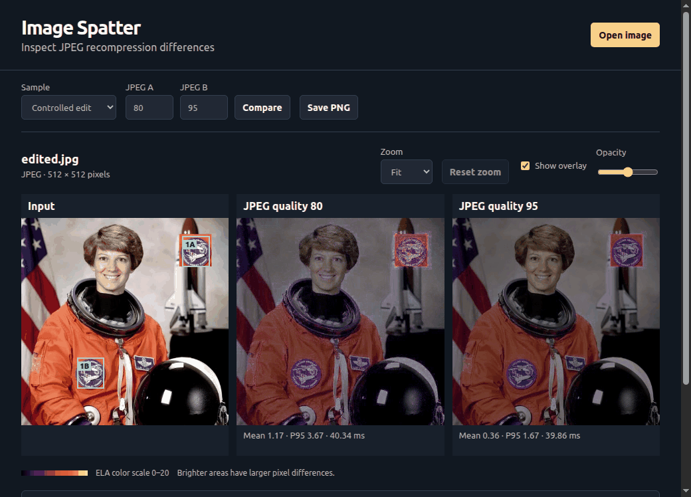

# Image Spatter Electron demosu

Kayıtlar, uygulamayla gelen kontrol ve kontrollü düzenleme örneklerini kullanır. Üç panelde giriş görüntüsü ve iki JPEG kalitesinin ELA haritaları gösterilir.

## JPEG kalitelerini karşılaştır

**Örnek** menüsünden **Kontrollü düzenleme** seçilir. Ardından **JPEG A** değeri 80’den 20’ye düşürülür ve **Karşılaştır** ile haritalar yeniden hesaplanır.

## Aynı bölgeyi üç panelde incele

%200 yakınlaştırmada bir paneli sürükleyince üç görünüm birlikte kayar. **Üst üste göster** ile ELA haritaları görüntünün üzerine gelir. Opaklık değiştirildikten sonra **Yakınlaştırmayı sıfırla** tam görüntüye döner.

## Karşılaştırmayı PNG olarak kaydet

**PNG olarak kaydet** ile giriş görüntüsü ve iki ELA sonucu tek bir dosyaya yazılır. PNG, tam görüntüleri JPEG kalite değerleri, ölçümler ve seçilen ELA katmanı opaklığıyla birlikte içerir.

[Kurulum ve çalıştırma](README.md#v1-masaüstü-uygulaması)
