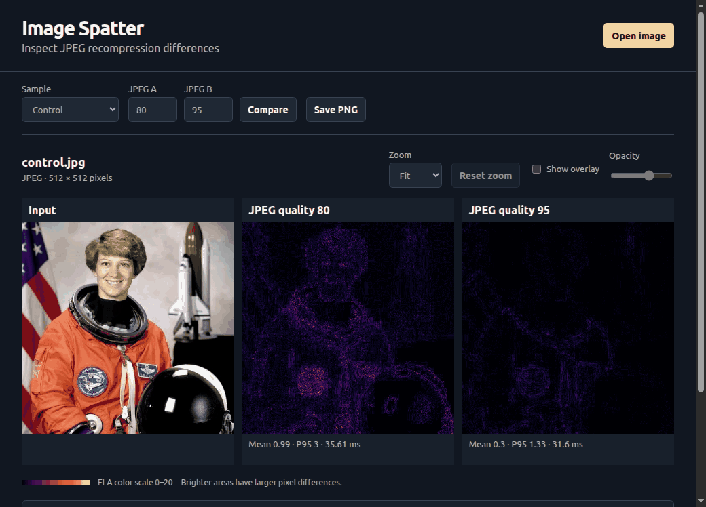
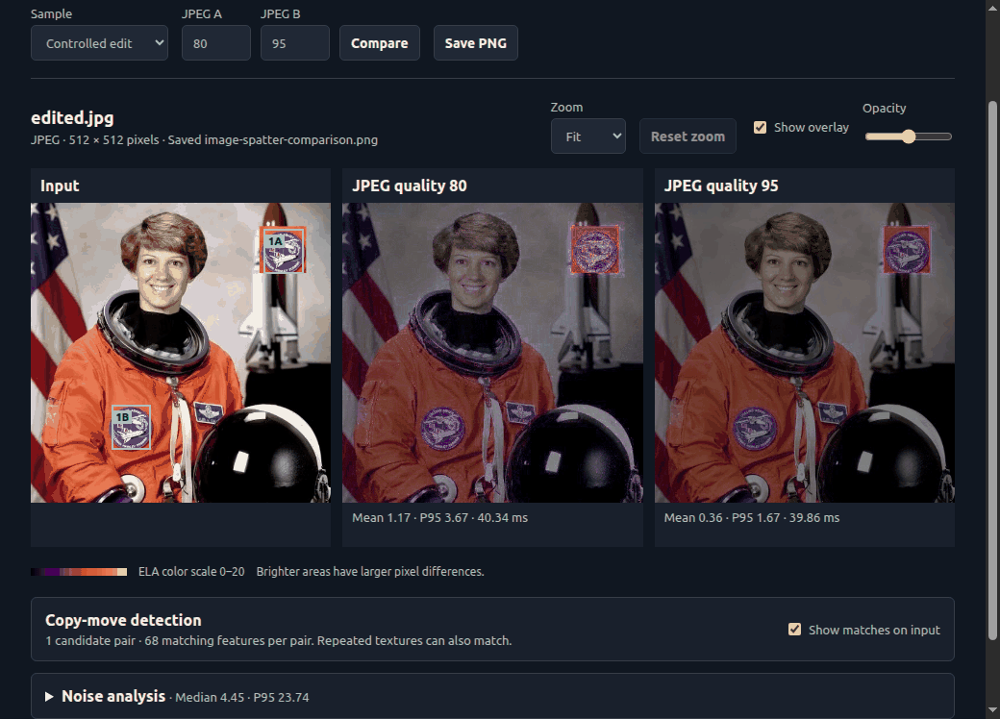

# Image Spatter Electron demo

Recorded in Desktop 1.3. The walkthrough uses the bundled control and edited images, plus synthetic noise and metadata fixtures.

## Compare JPEG qualities

Switch to **Controlled edit**, change **JPEG A** from 80 to 20, and select **Compare** to run the analysis again. The input panel shows the matched patch pair automatically.

## Inspect the same area in all three panels

Zoom to 200% and drag a panel to pan all three together. Use **Show overlay** and adjust **Opacity** to compare the heatmaps against the input. **Reset zoom** restores the full view.

## Compare noise and copy-move results

In **Controlled edit**, **Copy-move detection** marks the original badge and its pasted copy with paired A/B boxes. **Show matches on input** toggles those markers. The recording then opens a synthetic image with a known noisy rectangle. **Noise analysis** shows the input beside the local residual map and reports the median and P95. Brighter regions contain stronger fine-scale variation.

## Review metadata provenance clues

The demonstration image has synthetic camera and editor tags. **Metadata** highlights the camera make and model and a recognized editor in the Software field. **Highlighted fields only** hides the other entries.

## Save a PNG comparison

**Save PNG** exports the full input and both ELA views, including the JPEG settings, measurements, and overlay opacity.

[Setup and launch](README.md#desktop-application) · [Jupyter experiments](Image_Spatter_Demo.ipynb)
