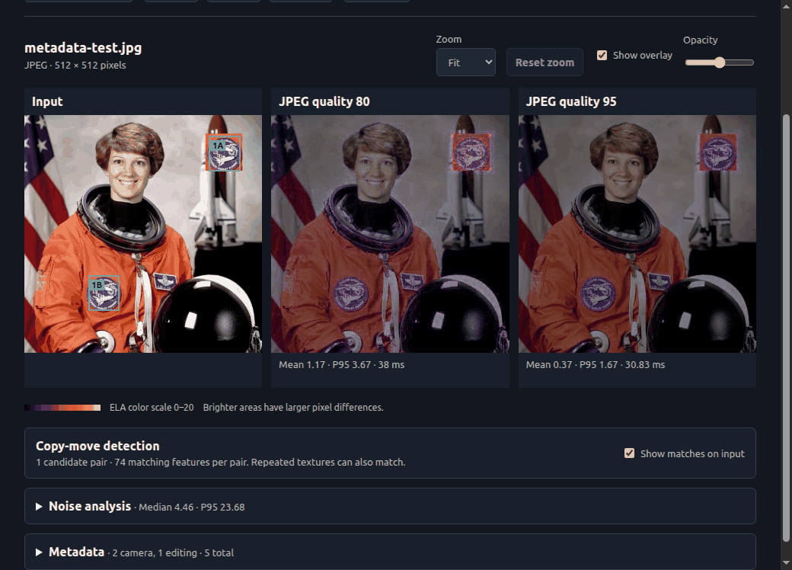

# Image Spatter Electron demo

These recordings use the bundled control and controlled-edit samples.

## Compare JPEG qualities

Switch to **Controlled edit**, change **JPEG A** from 80 to 20, and select **Compare** to run the analysis again. The input panel shows the matched patch pair automatically.

## Inspect the same area in all three panels

Zoom to 200% and drag a panel to pan all three together. Use **Show overlay** and adjust **Opacity** to compare the heatmaps against the input. **Reset zoom** restores the full view.

## Compare noise and copy-move results

In the current app, **Copy-move detection** labels candidate matching patches on the input with A/B markers. Open **Noise analysis** below the comparison to see the input beside the local residual map. Brighter regions contain stronger fine-scale variation.

## Review metadata provenance clues

The demonstration image has synthetic camera and editor tags. **Metadata** highlights the camera make and model and a recognized editor in the Software field. **Highlighted fields only** hides the other entries.

## Save a PNG comparison

**Save PNG** exports the full input and both ELA views, including the JPEG settings, measurements, and overlay opacity.

[Setup and launch](README.md#desktop-application)
